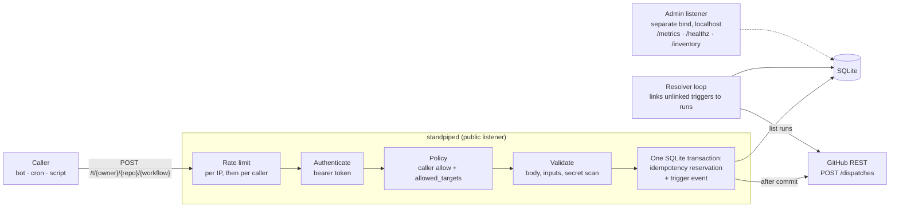
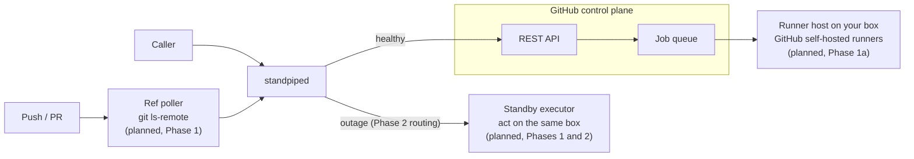

# [WIP] Standpipe

Standpipe is a self-hosted gateway that sits in front of GitHub Actions. GitHub's Actions control plane is the part of the pipeline that turns an event (a push, a pull request, an API dispatch) into a queued job, and that part can fail: during the incident of 6 August 2026 webhook delivery dropped to about 15%, pushes and pull requests did not start workflows at all, and GitHub reported that self-hosted runners were affected too. Adding self-hosted runners does not help, because a runner only pulls jobs from GitHub's queue. Dynamic `runs-on`, ARC and third-party runner providers all sit downstream of the same failing step. Standpipe owns the trigger URL instead, upstream of GitHub. Your bots, cron jobs and scripts send their triggers to Standpipe. While GitHub is healthy, Standpipe forwards each trigger and records it. The goal is that during an outage it runs the workflow on your own machine instead. That failover does not exist yet.

## Status

**Pre-alpha.** Read this section before anything else.

| Part | State |
|---|---|
| Phase 0 gateway (`standpiped`) in observation mode, and the operator CLI (`standpipe`) | Exists and is tested. The acceptance procedure passes end to end against a fake GitHub. |
| Phase 0 exit condition 4: a real caller goes through the gateway | **Open.** The gateway has run against the real `api.github.com` only on a failure path (an App ID that does not exist). The success path has run only against the fake. |
| Phase 1 packages: executor interface with an `act` engine (`internal/exec`), result validator (`internal/harness`), shadow ledger (`internal/shadow`) | Written and tested, but **not wired into any binary**. There is no `drill` command. |
| Drill score for the Phase 1 to Phase 2 promotion gate | **Never produced.** |
| Ref poller, local git mirror, runner host (Phase 1a), routing (Phase 2) | **Do not exist.** |

The gateway does not make routing decisions and cannot fail over. It authenticates, deduplicates, authorizes, forwards and records.

## Architecture today

This is what runs when you start `standpiped`.



- The idempotency reservation and the trigger event are written in one transaction, so every dispatch has a record. If the gateway cannot write to durable storage it returns `500` and does not dispatch.
- The gateway asks GitHub for the run id in the dispatch response (`return_run_details`). When that response is lost, for example after a timeout, the background resolver links the trigger to its run through an injected `standby_trigger_id` input shown in `run-name`, or, as a last resort, through a time window. Every link is labelled `exact`, `inferred`, `ambiguous` or `none`.
- `routing.json` is committed to the repository, but the Phase 0 gateway never reads it. It exists for the direct-call runbook.

## Planned architecture

Everything in this section is **planned**. None of it exists in the code today unless the status column says so.



### Roadmap

The work runs on two independent tracks. Track A (CI failover, Phases 0 to 2) is a complete product by itself and needs nothing from Track B.

| Phase | What | Done when | Status |
|---|---|---|---|
| **0** | Gateway, observation mode | A real caller goes through the gateway; `inventory` shows the bootstrapped trigger map and the coverage gap; `routing.json` is committed; a direct-call runbook exists | 3 of 4 conditions closed; the real caller is open |
| **1a** | Runner host, everyday value | Both GitHub Apps are created in one click from a setup page served by `standpiped` (App Manifest flow); `standpipe runner` registers self-hosted runners (ephemeral/JIT by default) on your homelab or VPS; at least one real repository's CI runs on them for 14 consecutive days | Planned; design not written |
| **1** | `act` executor and shadow mode | A workflow runs end to end while GitHub is unreachable; the ref poller produces synthetic triggers; `drill --exec` produces a score | Packages written and tested, not wired; no score |
| **2** | Routing | The promotion gate is passed; `route` can be flipped by hand; the commit-status write-back queue drains. The CI product is complete here | Planned |
| **2E** | Edge gateway (optional) | A second implementation of the gateway in TypeScript and Hono. It deploys to Cloudflare Workers with `wrangler`, or runs on Node, Bun or Deno, and passes the same acceptance tests as the Go gateway. The homelab agent connects out to it | Planned, after Phase 2 |
| 3 to 6 | Track B: archive, standby forge, PR failover with `reconcile`, continuous two-way sync | Collaboration failover beyond CI | Later |

Phases 1 and 1a both start after Phase 0 and run **in parallel**. Phase 1 does not wait for Phase 1a. The one link between them: Phase 1's executor and drill run on the host that Phase 1a sets up, so the drill uses the same machine, image, tools and cache as the GitHub job it is compared with.

Phase 2E is not written before Phase 2 is finished. The Go implementation stays the reference. A platform that cannot offer transactional storage (the idempotency reservation and the event write in one transaction) is not supported; on such a platform the edge gateway refuses to start. A thin edge layer that forwards straight to GitHub when the homelab gateway is unreachable is ruled out, because it would produce dispatches with no record.

**Promotion gate (Phase 1 to Phase 2):** 14 consecutive drill-days (a day on which the drill cannot run is dropped rather than resetting the count, so 14 drill-days span at most 21 calendar days), at least 20 distinct workflow runs after exclusions, a run-level `conclusion` match of at least 95%, and no unexplained mismatch in the last 7 days. The thresholds apply to the drill's `online` mode. The `offline` mode runs every drill-day and is reported, but is not held to the threshold. A matching `conclusion` alone is not accepted as proof: the gate also checks step identity and event-payload completeness.

### Phase 1a decisions (2026-11-09)

These decisions are settled; the Phase 1a design that implements them is not written yet.

- **How the runner host learns about queued jobs:** the `workflow_job` webhook. It arrives at the **gateway**, not at the homelab agent. The agent takes its work over a connection it opens **outward** to the gateway, so the agent never needs an inbound connection and works the same whether the gateway is on the same machine or at the edge (Phase 2E). API polling (costs quota) and the runner scale-set listener were considered and not chosen.
- **Two GitHub Apps.** The gateway App keeps its three Phase 0 permissions (Actions: read and write, Contents: read, Metadata: read) with its webhook off. A separate, optional **runner App** carries the runner permissions (repository Administration: write, or organization Self-hosted runners: write) and the `workflow_job` webhook. Each App has its own App ID and private key, so a leaked key only exposes that App. A repository without the runner App installed is shown as such in `status` and `inventory`.
- **Every webhook delivery is signature-checked** (`X-Hub-Signature-256`). A delivery that fails verification is counted and visible, not dropped silently.
- **Missed webhooks:** a warm pool of N idle ephemeral runners (default N=1) pulls jobs from GitHub by itself, and the agent replaces each runner locally when it exits, so normal load does not depend on the webhook. The webhook only adds runners above N. A sparse outbound reconciliation poll (default every 2 to 5 minutes) asks the REST API for queued jobs that match our labels and have waited too long with no runner; when it finds one it starts a runner and increments a "webhook missed" counter. Whether `workflow_job` deliveries to Apps were throttled on 6 August 2026 was not measured; the risk is treated as possible, not observed.
- **Open measurement:** how long a pre-fetched JIT runner configuration stays valid, and whether a long-idle ephemeral runner keeps its connection, is **unmeasured**. It will be measured against GitHub before the warm pool is coded.
- **Self-hosted runner minutes are treated as free** today. If GitHub starts charging for them, Phase 1a's rationale becomes outage insurance plus a local cache rather than savings.

### Track H: open source and self-hostable

Track H is not a phase. It is a set of conditions every phase's delivery has to meet.

| # | Condition | Status |
|---|---|---|
| H-1 | A license is chosen and `LICENSE` is in the repository | Open |
| H-2 | English `README.md` and a 10-minute quickstart | Open |
| H-3 | Single binary plus a `docker compose` example; `linux/amd64` and `linux/arm64` releases | Open |
| H-4 | Cloudflare Tunnel access documented: only the `/t/` trigger surface goes through the tunnel (from Phase 1a also the signature-checked webhook path); the admin listener, `/metrics` and the setup page never do, or sit behind Cloudflare Access | Open |
| H-5 | The no-inbound-connection path documented: the runner agent and the ref poller only connect outward; the App Manifest flow can return to `localhost` through the browser | Open; the `localhost` return is not measured. From Phase 1a GitHub's webhook also comes in through the tunnel, so the claim covers the agent and the poller, not the gateway |

## Quickstart

There are no release binaries yet. Build from source (Go 1.27 or later; no C toolchain needed, SQLite is pure Go):

```sh
git clone https://github.com/fatihy101/standpipe.git
cd standpipe
CGO_ENABLED=0 go build -o bin/ ./cmd/...
# bin/standpiped  the gateway daemon
# bin/standpipe   the operator CLI
```

Then follow [docs/setup.md](docs/setup.md): create the GitHub App, write `standpipe.yaml`, mint a caller token, migrate, onboard a repository and send a first trigger.

## Documentation

| Document | Contents |
|---|---|
| [docs/setup.md](docs/setup.md) | First installation, from creating the GitHub App to the first traced trigger |
| [docs/runbook.md](docs/runbook.md) | Direct-call runbook: what callers do when the gateway is unreachable |
| [docs/architecture.md](docs/architecture.md) | Architecture and interactions, with diagrams |
| [docs/reference/metrics.md](docs/reference/metrics.md) | Prometheus metrics |
| [docs/reference/tokens.md](docs/reference/tokens.md) | Caller and admin tokens |
| [docs/reference/hash-scopes.md](docs/reference/hash-scopes.md) | Content-hash scopes and integrity checks |
| [docs/reference/health.md](docs/reference/health.md) | Health endpoints and `status` |
| [docs/reference/drill-rules.md](docs/reference/drill-rules.md) | Drill rules for the promotion gate |
| [docs/index.html](docs/index.html) | Single-page overview |

## Known limits

- Deploys that use OIDC cannot run elsewhere: a cloud role that trusts GitHub's issuer will not trust your machine. Phases 1 and 2 run tests and builds; deploys stay manually approved.
- Workflows marked `shadow: never` (typically deploy and release) are never rehearsed, so the most valuable path is the least tested.
- In normal times jobs would run on GitHub's `actions/runner`; during an outage they would run under `act`. They are not the same engine, even on the same machine. `act`'s exit code is not a `conclusion` signal, and it can agree with GitHub for the wrong reason. Measured run-level agreement was 96.0% (88.0% with the image as provisioned), n=25, and job-level agreement was 83.8%.
- About 40% of real runs talk to GitHub while they execute. Those steps fail in a full outage no matter where they run.
- Standpipe would publish commit statuses, while Actions produces check runs. A required check that never reports under its name stays pending, so a PR can stay blocked after CI passes.
- The gateway is an unmitigated hop in Phases 0 to 2. Cloudflare Tunnel, if you use it, is another one. The mitigation for both is the committed `routing.json` and the [direct-call runbook](docs/runbook.md).
- From Phase 1a, runners and the standby executor share one host, so that host is a single point of failure.
- The Phase 2E edge gateway does not remove the dependency; it moves it from your homelab to the edge platform.
- Exact correlation after a lost dispatch response needs the operator to add the `standby_trigger_id` input to each workflow. Without it the fallback is `inferred` or `ambiguous`. `inventory` shows `correlation_ready` per workflow.
- A self-hosted runner on a public repository lets a fork PR run arbitrary code on your hardware. Phase 1a will default to private repositories and ephemeral runners, with public repositories as an explicit opt-in.

## Out of scope

Permanently out of scope: translating Actions YAML to another CI language; a code-review UI or issue tracker; a general-purpose artifact store; GHES installation; carrying approvals across forges as approvals; selling a hosted runner service. Managing runners on **your own** machines (homelab, VPS) is in scope. Running other people's jobs on our machines is not.

## License

License: not yet chosen.
