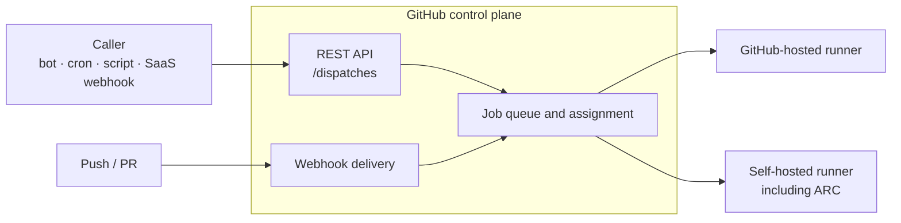
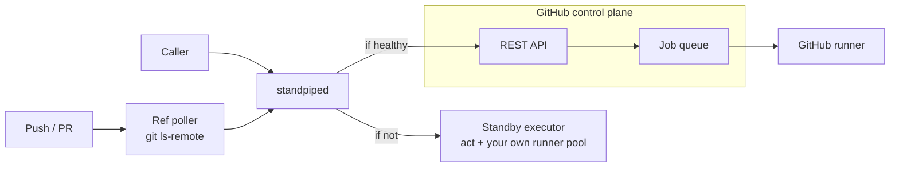
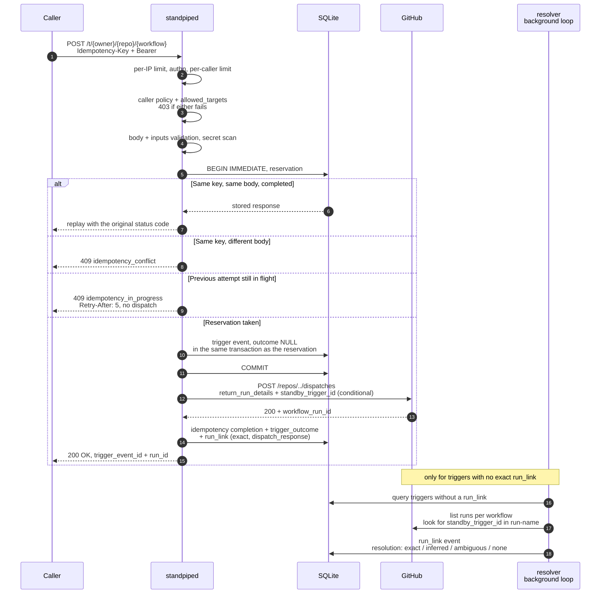
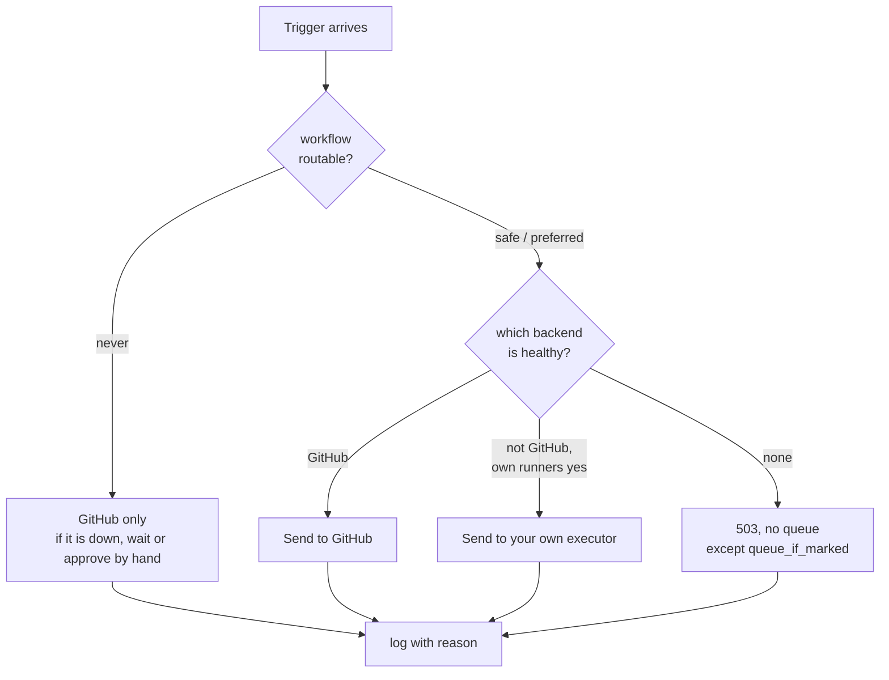
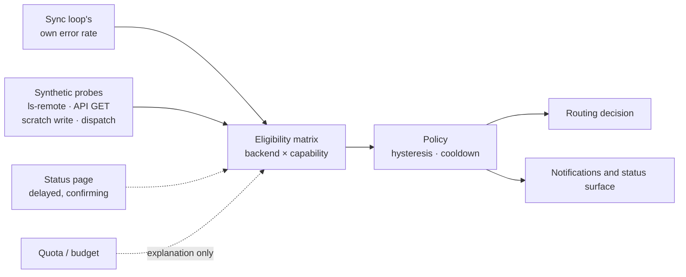
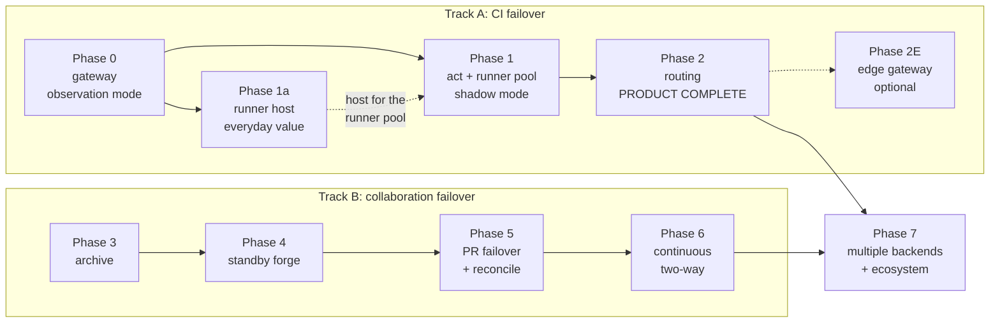
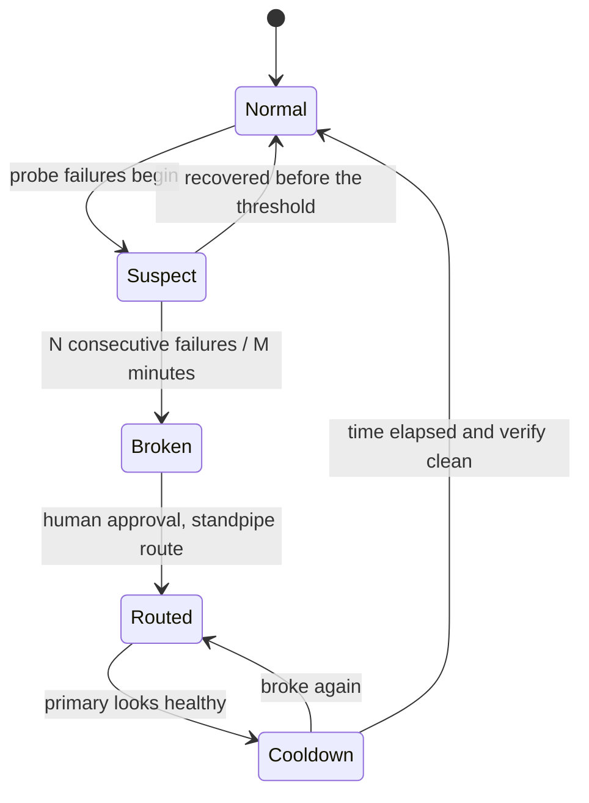
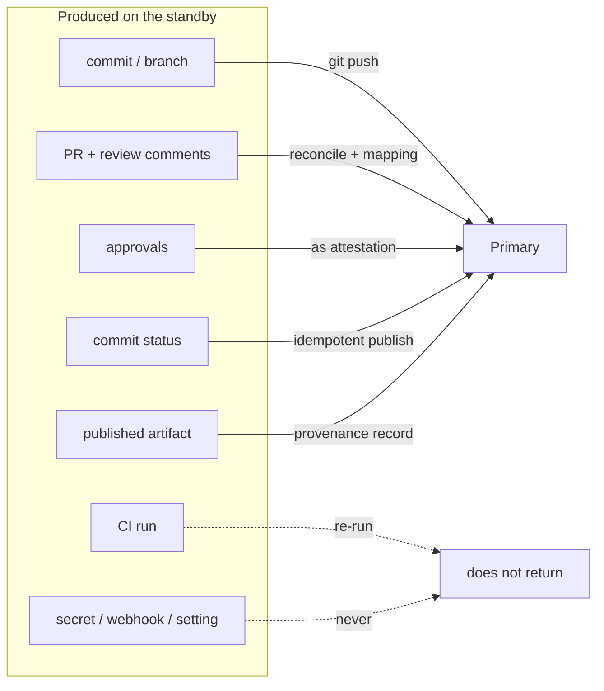

# Standpipe architecture and interactions

This document answers "what are we actually building" with diagrams rather than paragraphs. It covers what exists today (the Phase 0 gateway) and what is planned. Every planned part is marked as planned; see the [status section of the README](../README.md#status) for the current state of each one.

---

## 1. Thesis: why the gateway sits upstream of the control plane

This is the reason the project exists. Before a CI job can exist, an **event** has to be processed by the control plane. Where the runner is only matters *after* the job has been created.

### Today

On 6 August 2026 the box that failed was inside `GH`: webhook delivery dropped to **15%**, so the `P --> WH --> Q` arrow did not carry anything and **no job was created**. Self-hosted runners were affected as well, because they sit *downstream* of `Q`.

Consequence: every mitigation that stays inside GitHub (dynamic `runs-on`, ARC, third-party runner providers) lives downstream of the same failing pipeline.

### With Standpipe (planned)

Two arrows matter. `C --> GW` catches programmatic triggers **before** the control plane. `P --> POLL --> GW` produces push and PR triggers through a path that does not depend on webhooks at all; the poller relies on the fact that git reads usually keep working during partial outages.

Today only `C --> GW --> API` exists. The ref poller, the standby executor and the routing decision are planned.

---

## 2. Trigger paths and coverage

| Path | Carried today by | In Standpipe |
|---|---|---|
| Programmatic dispatch | GitHub REST API | **Gateway**, from Phase 0 (exists) |
| Push / PR | GitHub webhook delivery | **Ref poller**: produced in Phase 1, routed in Phase 2 (planned) |
| Scheduled (`schedule`) | GitHub cron | Local cron calling the gateway (Phase 2, planned) |
| `repository_dispatch` | GitHub REST API | **No trigger surface**, but it counts in the coverage gap and is reported as a `structural` gap |
| Other events | GitHub webhooks | **Out of scope**: `deployment`, `check_run`, `merge_group` and so on |

If the poller and GitHub both trigger the same commit, the run happens twice; the dedupe key is `{sha, workflow}`.

The coverage gap is the set of triggers that appear in run history but never went through the gateway. It does not converge to zero and is not expected to. Two classes are reported separately: **`migratable`** (a known caller using `workflow_dispatch`, which can be moved to the gateway; this is Phase 0's measure of success) and **`structural`** (manual triggers from the GitHub UI, `repository_dispatch`, accepted direct calls).

---

## 3. Phase 0: request flow

Observation mode: authenticate, apply idempotency, authorize, forward to GitHub, record everything. No decisions, no routing. The only change made to the incoming request body is the injection of `standby_trigger_id`, and only when the workflow definition declares that input.

Three things in this diagram are deliberate.

**The reservation and the event write share one transaction.** So an `event_id` is never dangling, and the state "dispatched but no record" cannot be produced. A gateway that cannot write to durable storage does not dispatch; it returns `500`, because an unrecorded dispatch is worse than a recorded one.

**Run correlation is a three-tier hierarchy.** Tier 1: the gateway sends `return_run_details`, and GitHub answers `200` with `workflow_run_id` instead of `204`; the link is written as `exact` with source `dispatch_response`, in the same transaction as the completion, and needs no change to your workflow. Tier 2, the recovery path: a dispatch that times out leaves no response body to read, and that outage case is exactly why the product exists. The background resolver then looks for the injected `standby_trigger_id` in the run's `run-name` (`exact`, source `run_name`). This needs the operator to declare the input in the workflow. Tier 3: a time window plus ref match, producing `inferred`, `ambiguous` or `none`. The resolver's state lives in the database, so a restart does not lose pending correlation. The result is never `NULL`; it is one of four `resolution` values.

**The response is `200`, not `202`.** Part of the work is asynchronous, but that is an internal detail of the gateway: the caller gets `trigger_event_id` and the idempotency state synchronously.

---

## 4. Phase 2: the routing decision (planned)

One decision surface. **Budget does not enter this flow at all**; it only feeds the explanation shown to the operator.

The typical reason for `routable: never` is OIDC: a cloud role that trusts GitHub's issuer cannot be assumed from your own runner without setting up a new trust relationship.

---

## 5. Health and eligibility signals (planned)

Solid arrows decide; dashed arrows only produce explanations. The status page lags by 15 to 45 minutes and is biased in the vendor's favour, so it is **never a primary trigger**.

---

## 6. Two independent tracks

Phases 1 and 1a proceed **in parallel** after Phase 0. Phase 1 does not wait for Phase 1a. The dashed arrow is the only link: Phase 1's runner pool runs on the host Phase 1a sets up, so the drill runs on the same machine, with the same image, tools and cache, as the GitHub job it is compared with. Phase 2E is optional and is not written before Phase 2 is finished.

Track A needs **none** of the archive and epoch machinery. Missing this split was the mistake of an earlier ordering, which put the hardest phases in front of the most valuable one.

### Phase 1a decisions

The Phase 1a design is not written yet. These decisions (2026-11-09) bound it:

- The `workflow_job` webhook tells the runner host about queued jobs. It belongs to a separate **runner App** and arrives at the **gateway**, not at the agent. The agent takes its work over a connection it opens outward to the gateway; the protocol (WebSocket, long polling or similar) is chosen in the Phase 1a design.
- The **gateway App** keeps three permissions (Actions: read and write, Contents: read, Metadata: read) and its webhook stays off. The **runner App** is created only when the runner feature is turned on, with repository Administration: write or organization Self-hosted runners: write, and the `workflow_job` webhook on. Each App has its own ID and key; both are installed per repository.
- The webhook URL is needed when the App is created (the manifest's `hook_attributes.url` requires a public address), so the tunnel, or the edge gateway in Phase 2E, has to exist before the setup page is used.
- No webhook delivery is processed without verifying `X-Hub-Signature-256`. Failed verifications are counted.
- A warm pool (default N=1 idle ephemeral runner) keeps normal load independent of the webhook; a sparse outbound reconciliation poll (default 2 to 5 minutes) catches jobs whose delivery was missed and increments a "webhook missed" counter.
- How long a pre-fetched JIT configuration stays valid, and whether a long-idle ephemeral runner keeps its connection, is unmeasured and has to be measured before the warm pool is coded.

---

## 7. Outage and return (planned)

The asymmetry is deliberate: react **fast to breakage and slowly to recovery**, because going back has a reconciliation cost and flapping is the most expensive state.

---

## 8. Back-sync: what returns and what does not (Track B, planned)

This applies only to Track B. The dividing line is idempotency: anything that can be reproduced is not carried back.

`reconcile` is the only path that writes **archive data** to the primary. Three narrow exceptions sit outside that rule: proxying a caller's trigger, publishing commit status, and the health probe's write to its scratch ref.

---

## 9. Actors

| Actor | What it does | From phase | Exists today |
|---|---|---|---|
| **Caller** | Triggers a pipeline programmatically; comes to the gateway with a token | 0 | Yes (your bots and scripts) |
| **standpiped** | Authenticates, applies idempotency, authorizes, forwards, records | 0 | Yes |
| **Resolver loop** | Finds triggers without a `run_link` and matches them to runs | 0 | Yes |
| **GitHub client queue** | Queues every GitHub call with per-installation quota awareness | 0 | Yes |
| **Admin listener** | Separate bind: `/metrics`, `/healthz`, `/inventory`, kept apart from the public surface | 0 | Yes |
| **Operator** | Adds the `standby_trigger_id` input to workflows; the gateway never writes it | 0 | Yes |
| **Setup page** | Creates two separate Apps with the App Manifest flow: the gateway App (three permissions, webhook off) and the optional runner App (runner permissions, `workflow_job` webhook). It is **never** exposed through the tunnel | 1a | No |
| **Homelab agent** (`standpipe runner`) | Manages registered self-hosted runners (ephemeral/JIT by default); takes its work over a connection it opens **outward** to the gateway | 1a | No |
| **Ref poller** | Polls watched refs and produces synthetic triggers for push and PR | 1 | No |
| **Standby executor** | Runs the workflow with `act` on your own runner pool | 1 | Packages only, not wired into a binary |
| **Policy engine** | Produces eligibility from health and capability fit | 2 | No |
| **Edge gateway** | Second implementation of the gateway (TypeScript + Hono); passes the same acceptance tests as the Go gateway; the homelab agent connects out to it | 2E (optional) | No |
| **Sync daemon** | Pulls forge metadata into the archive | 3 | No |
| **`reconcile`** | Writes the work done on the standby back to the primary | 5 | No |

---

## 10. What the diagrams do not say: known limits

- **`routable: never` jobs are not moved.** Deploys that use OIDC wait for GitHub during an outage, or are approved by hand.
- **`shadow: never` jobs are never rehearsed.** The most valuable path is the least tested.
- **`act`'s outage dependency is smaller than it looked; the real limit is fidelity.** Offline actions and URL rewriting are existing `act` flags (`--action-offline-mode`, `--local-repository`), and a local mirror is only needed for `actions/checkout` with an explicit `ref:` or `repository:`. The real limit is that `act` can agree with GitHub *for the wrong reason*: its exit code is not a `conclusion` signal. A job on an unsupported platform does not run, writes no result, and the process exits 0. `on.push.branches` and `paths` filters are not applied. Measured agreement at run level was 96.0% with a platform-resolved image and 88.0% with the image as provisioned (n=25); at job level it was 83.8%. In one measured case a run matched perfectly while `act` had run none of the work. The drill therefore also checks the planned job set, step identity and event-payload completeness.
- **About 40% of real runs talk to GitHub while they run.** No mirror can answer a query to a service that is down, so those steps fail in a full outage wherever they run. This is why the promotion gate applies its threshold to the drill's `online` mode only.
- **Commit status is not a required check.** Actions produces check runs; a required check that never reports under its name stays pending, so green CI may not unblock a PR.
- **The gateway is an unmitigated hop in Phases 0 to 2.** Mitigation: the `routing.json` committed to the repository and the [direct-call runbook](runbook.md).
- **Cloudflare Tunnel is another hop.** It is a dependency independent of GitHub; if it goes down, the mitigation is again the direct-call runbook. Only `/t/` goes through the tunnel, plus the signature-checked webhook path from Phase 1a.
- **One machine, one point of failure (Phase 1a).** If the runners and the standby executor are on the same host, losing the host loses both. For a homelab this is an accepted cost, and it is stated, not hidden.
- **The normal engine and the outage engine are not the same (Phase 1a).** In normal times GitHub's `actions/runner` runs the job; during an outage `act` does. Running on the same machine does not make their fidelity equal.
- **The edge gateway does not remove the dependency, it moves it (Phase 2E).** A homelab power or internet outage no longer stops the forwarding path; an outage of the edge platform does.
- **Correlation after a lost response depends on the operator's workflow change.** Without the `standby_trigger_id` input there is no exact match on the recovery path; the time-window fallback produces `inferred` or `ambiguous`. Which workflows are ready shows up as `correlation_ready` in `inventory`.
- **Input validation is skipped for a workflow definition that was never fetched.** The workflow cache is persistent and survives restarts, but a workflow that has never been seen cannot be validated. This degradation is published with a counter, not passed silently.
- **Self-hosted runners on public repositories are dangerous (Phase 1a).** A fork PR runs arbitrary code on your hardware. Default: private repositories and ephemeral (JIT) runners only; a public repository needs an explicit opt-in.
- **Quota is not a routing trigger**, only a diagnostic input.
